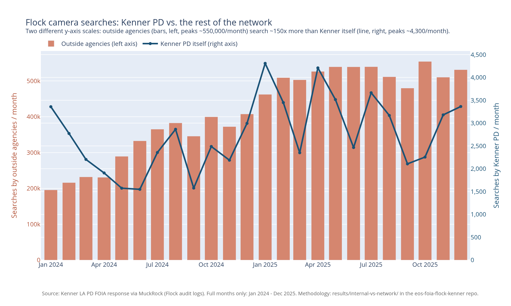
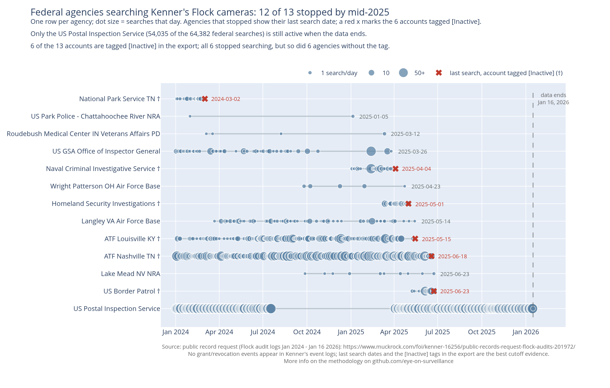
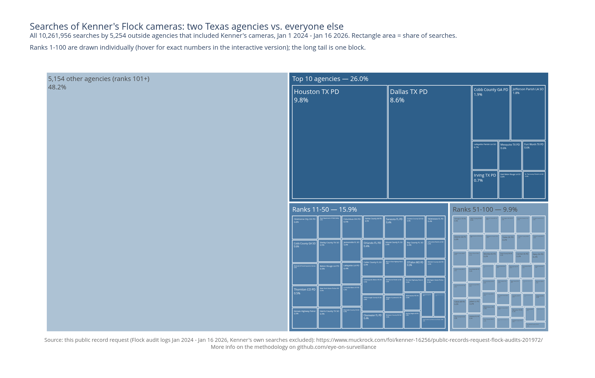
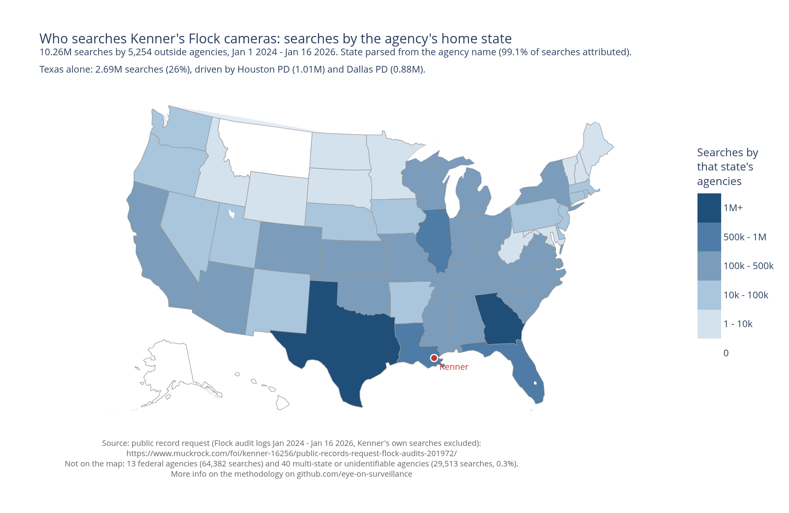
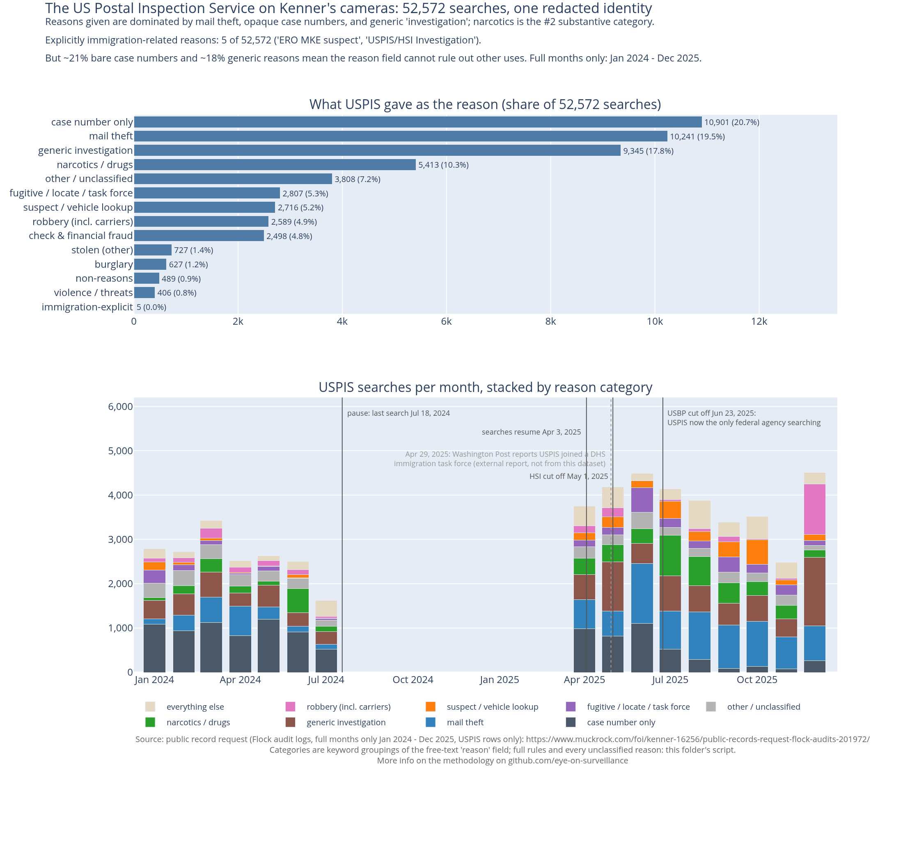
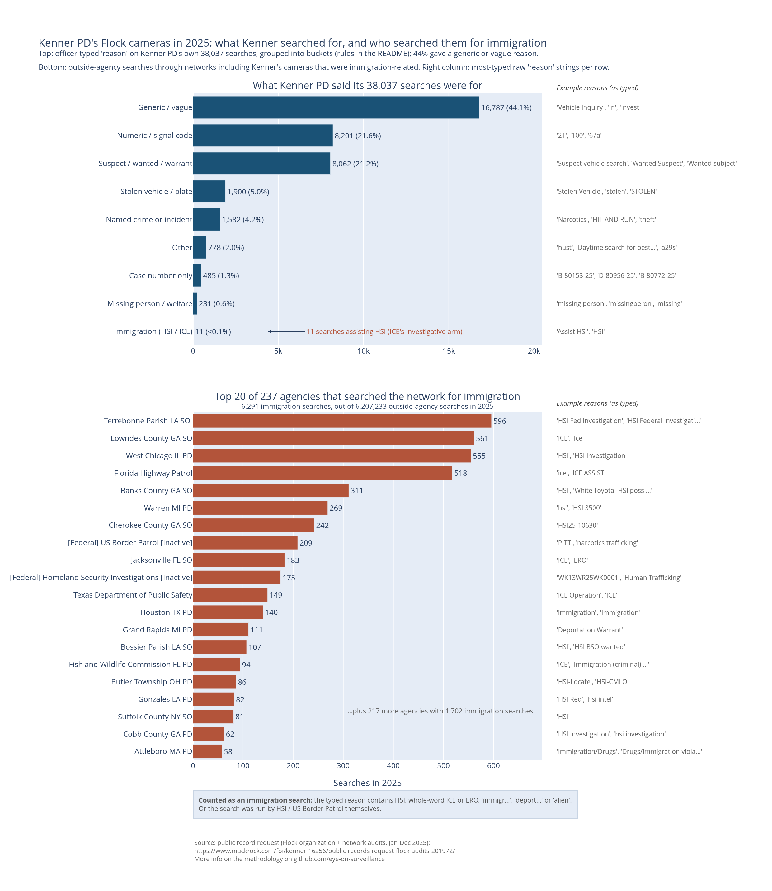
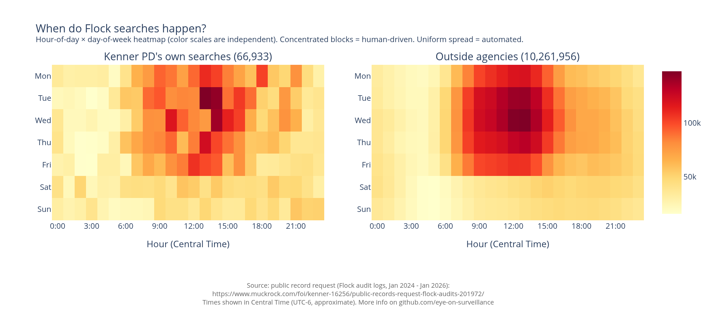

# Usage of Kenner PD Flock Camera. 2024/2025

This is an overview of the data analysis Eye On Surveillance ran over the result of a public records request, focused on the usage of Flock camera in Kenner, LA. 
The raw data, as provided by Kenner PD, is accessible [here(https://www.muckrock.com/foi/kenner-16256/public-records-request-flock-audits-201972/) for your own examination. 
For conveniance, we aggregated the raw data in a small database. Our methodology is described at the root level of this repository. 

The reader can examine how we got there, and redo those graph from scatch himself.

Each visualisation gets a folder with the detailed calculation for that graph.
Inside each folder: a small and self-contained script to generate the graph, the map, or the data-viz.
We try to keep it to basic SQL queries on the SQLite db built by `../setup-scripts/`.

You can also look at the same data in the haveibeenflocked database, and see much more, nationwide FOIA results. 
In this repository, the goal is to focus on Kenner, LA. 
But you can look at nationwide usage of Flock Safety camera there : https://haveibeenflocked.com/reports 

## Internal usage VS network usage

This graph shows the massive discrepancy between internal queries of those cameras, and external usage, made by police departments. Sometimes very far away.
The ratio is roughly 500k queries per month from the Flock network, to 3 or 4,000 a month from Kenner police department.

See raw numbers and methodology: [`internal-vs-network/`](internal-vs-network/)

## Federal agencies access timeline

13 federal agencies searched Kenner's cameras through the Flock network, including Homeland Security Investigations (175 searches, ending May 1, 2025) and US Border Patrol (209 searches, ending June 23, 2025).
12 of the 13 had stopped by mid-2025.
6 of the 13 accounts are tagged `[Inactive]` in Flock's own export.

The exception is the US Postal Inspection Service: 54,035 searches, still running when the data ends, after an 8-month pause from July 2024 to April 2025.

See raw numbers and methodology: [`federal-access-timeline/`](federal-access-timeline/)

## Who searches Kenner's cameras: concentration

5,254 outside agencies searched Kenner's cameras. Two of them, Houston TX PD (9.8%) and Dallas TX PD (8.6%), account for more searches than the next 48 agencies combined.
The concentration is double-edged: the top 100 agencies represent 51.8% of the 10.26 million outside searches, but the long tail of 5,154 smaller agencies still adds up to 48.2%.

See raw numbers and methodology: [`agency-concentration/`](agency-concentration/)

## Where the searches come from

Agencies from 47 states plus Washington DC searched Kenner's cameras.
Only Alaska, Hawaii and Montana never did.
Texas leads by far, followed by Georgia, Florida, Louisiana and Illinois.
The state is parsed from the agency's name (two-letter code or full state name), which attributes 99.1% of the searches; the remaining 0.3% are multi-state bodies (regional intelligence centers, railroads, NCMEC) listed in the script's output.
The median agency ran just 221 searches that touched Kenner's cameras over the two years.

See raw numbers and methodology: [`searches-by-state/`](searches-by-state/)

## Focus US Postal Inspection Service 

The Postal Service's police ran 52,572 searches touching Kenner's cameras in full months alone (Jan 2024 - Dec 2025) — more than the other 12 federal agencies combined.

The reasons they gave are dominated by mail theft (20%), bare case numbers (21%), and generic "investigation" (18%); narcotics is the second substantive category (10% plus the `PMN`-coded cases). 489 searches gave non-reasons like `test` or `Image Download`.

On the immigration question: exactly 5 of the 52,572 searches carry explicitly immigration-related reasons (`ERO MKE suspect`, `USPIS/HSI Investigation`), all of them after April 2025.
The timeline is what stands out: USPIS stopped searching entirely from July 18, 2024 to April 3, 2025, resumed at higher volume than before, and after Border Patrol's access ended on June 23, 2025 it became the only federal agency still searching Kenner's cameras.
The data cannot say what the opaque searches (case numbers, generic reasons) were for — only that the reason field can neither confirm nor rule out uses beyond postal crime.

*External context, not derived from this dataset:* on April 29, 2025 the [Washington Post reported](https://www.washingtonpost.com/business/2025/04/29/usps-immigration-trump-deportations/) that USPIS had joined a DHS task force locating undocumented immigrants, prompting a [House Oversight inquiry](https://oversightdemocrats.house.gov/imo/media/doc/2025-06-11.lynch-et-al-to-postal-service-and-uspis-re-immigration.pdf); separately, USPIS has been running [Project Safe Delivery](https://www.uspis.gov/project-safe-delivery) against the national wave of mail theft and letter-carrier robberies since 2023, which is consistent with the mail-theft-heavy reasons above.

See raw numbers, the full classification rules, and every unclassified reason: [`usps-deep-dive/`](usps-deep-dive/)

## 2025 search reasons, and immigration use of the network

Kenner PD ran 38,037 searches in 2025; 44% gave a generic or vague reason ("invest", "in", a bare "c"), 21.6% just a signal code, and 11 assisted HSI, ICE's investigative arm.
On the network side, 6,291 of the 6,207,233 outside-agency searches in 2025 were immigration-related — an HSI / ICE / ERO / deportation reason typed by 237 agencies, or HSI and Border Patrol searching directly.
Each bar shows the most-typed raw reasons next to it; the immigration formula and its 40 hand-reviewed false positives are documented in the folder.

See raw numbers and methodology: [`search-reasons-2025/`](search-reasons-2025/)

## When do the searches happen

Searches concentrate on weekday business hours, peaking midday Tuesday and Wednesday: Mon-Fri 8am-6pm accounts for 49.8% of Kenner PD's own searches and 52.5% of the outside agencies'.
But the cameras are queried around the clock — about 17% of searches on both sides run overnight (10pm-6am).

See raw numbers and methodology: [`temporal-patterns/`](temporal-patterns/)
