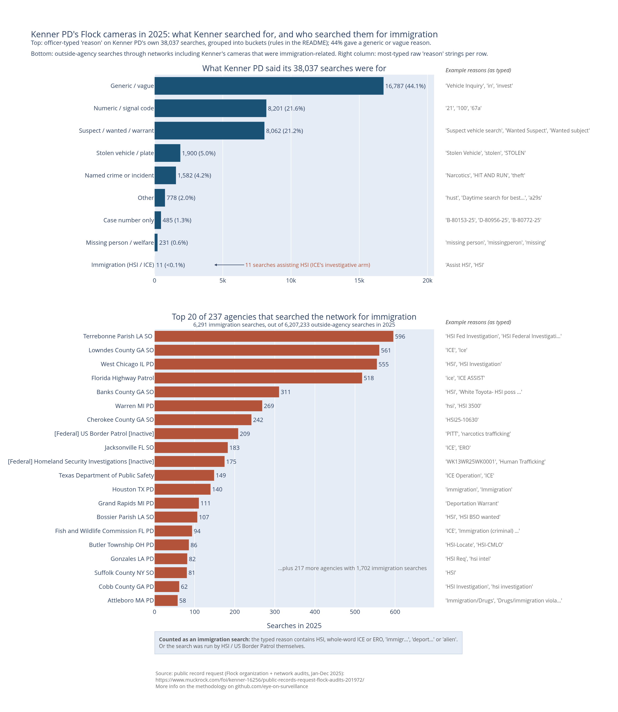

## Kenner PD Flock camera usage.




## Top panel: Kenner PD reasons for searches breakdown

Every search carries a "Reason" field. In Kenner's 38,037 searches of 2025 there are 429 distinct reason strings: full words ("Stolen Vehicle"), fragments ("invest", "in"), local signal codes ("67a", "107"), bare case numbers ("d-80956-25"), single characters ("c", "."), and 213 searches whose entire stated reason is "test".

Like in `results/usps-deep-dive/`, the sorting works as a checklist read top to bottom, first match wins. The complete rules are the `CASE` expression in `search_reasons_2025.py` — the query *is* the methodology. In short:

1. **Immigration (HSI / ICE)** is pulled out first so it can never be absorbed into a bigger bucket. The rule matches HSI, whole-word ICE, whole-word ERO, "immigr…", "deport…", "alien". There is deliberately **no exclusion list**: instead the script prints every raw reason string that lands in this bucket, so a false positive (the network audit has phrases like "ice cream thefts") would be visible in the output, not silently pre-filtered. On Kenner's 2025 searches the bucket contains exactly 11 rows: "Assist HSI" (9) and "HSI" (2).
2. **Stolen vehicle / plate**, **Suspect / wanted / warrant**, **Missing person / welfare**, **Named crime or incident** — keyword groups, misspellings included ("shoting", "extotion", "stoen").
3. **Numeric / signal code** — reasons that are just numbers or short local codes ("21", "67a", "107", "cfs 90"). These presumably decode to real offense types in Jefferson Parish radio codes, but we don't guess; they get their own bucket instead of being folded into crime categories.
4. **Case number only** — patterns like "d-80956-25": *something* was being investigated, but the log doesn't say what.
5. **Generic / vague** — "investigation" and its many fragments and typos, "vehicle inquiry", "in", "c", ".", "dispo", "test", "undefined". At 16,787 searches this is the biggest bucket: 44% of Kenner's searches state no specific reason at all.
6. Whatever fits nothing above stays **Other** (778 searches, 2%) on purpose rather than being force-fitted.

The script refuses to write the graph unless the buckets sum to exactly 38,037, so no row can be dropped or double-counted.

| Bucket | Searches | Share |
|---|---:|---:|
| Generic / vague | 16,787 | 44.1% |
| Numeric / signal code | 8,201 | 21.6% |
| Suspect / wanted / warrant | 8,062 | 21.2% |
| Stolen vehicle / plate | 1,900 | 5.0% |
| Named crime or incident | 1,582 | 4.2% |
| Other | 778 | 2.0% |
| Case number only | 485 | 1.3% |
| Missing person / welfare | 231 | 0.6% |
| Immigration (HSI / ICE) | 11 | <0.1% |
| **Total** | **38,037** | 100% |

## Sourcing the total numbers of searches.

Every number below comes from one SQL query against `cache/flock.db`; run them yourself with `sqlite3 cache/flock.db "<query>"`. 

**Kenner PD used Flock 38,037 times in 2025:**

```sql
SELECT COUNT(*) FROM org_audit
WHERE search_time >= '2025-01-01' AND search_time < '2026-01-01';
-- 38037
```

**…and let 4,902 outside agencies run 6,207,233 searches through networks that include Kenner's cameras:**

```sql
SELECT COUNT(DISTINCT org_name), COUNT(*) FROM network_audit
WHERE search_time >= '2025-01-01' AND search_time < '2026-01-01'
  AND org_name != 'Kenner LA PD';
-- 4902 | 6207233
```

(Kenner appears in its own network audit — its searches also cover its own cameras — so those rows are excluded here, same as in `results/internal-vs-network/`.)

One caveat that applies everywhere below: a network-audit row means the search *covered a camera network that includes Kenner's cameras*, typically alongside thousands of other cameras. It does not mean the searcher was specifically after a vehicle in Kenner.

## Immigration use

Kenner PD itself logged 11 searches assisting HSI (Homeland Security Investigations — ICE's investigative arm), plus one more in 2024. But Kenner's cameras sit inside Flock's shared network, and the network audit shows the immigration use happening *through* them:

**Immigration agencies searched directly.** Two show up by name among the 4,902 agencies:

```sql
SELECT org_name, COUNT(*) FROM network_audit
WHERE search_time >= '2025-01-01' AND search_time < '2026-01-01'
  AND org_name IN ('[Federal] Homeland Security Investigations [Inactive]',
                   '[Federal] US Border Patrol [Inactive]')
GROUP BY org_name;
-- [Federal] Homeland Security Investigations [Inactive] | 175
-- [Federal] US Border Patrol [Inactive]                 | 209
```

**Other agencies searched on immigration's behalf.** Matching the same term list as the graph's immigration bucket (HSI, whole-word ICE, whole-word ERO, "immigr…", "deport…", "alien") against the 6.2M outside-agency reasons:

```sql
WITH n AS (
  SELECT org_name,
         LOWER(TRIM(COALESCE(reason,''))) AS l,
         ' ' || LOWER(TRIM(COALESCE(reason,''))) || ' ' AS p
  FROM network_audit
  WHERE search_time >= '2025-01-01' AND search_time < '2026-01-01'
)
SELECT COUNT(*), COUNT(DISTINCT org_name) FROM n
WHERE l LIKE '%hsi%' OR p LIKE '% ice %' OR p LIKE '% ero %'
   OR l LIKE '%immigr%' OR l LIKE '%deport%' OR l LIKE '%alien%';
-- 5948 raw matches
```

The raw match count is 5,948. Because whole-word "ice" also matches things that have nothing to do with the agency, every distinct matched phrase was reviewed by hand, and **40 rows were excluded** — all of them, in full, so the judgment call can be audited:

| Agency | Reason | Rows | Why excluded |
|---|---|---:|---|
| Putnam County FL SO | "LEMON ICE" / "Lemon Ice" | 5 | ambiguous — not guessed to be the agency |
| Florence County SC SO | "ICE STORM" | 6 | searched Feb 27, 2025 — the winter storm |
| Griffith IN PD | "ice cream thefts 2011 n griffith blvd…" | 4 | literally ice cream |
| [Federal] US Postal Inspection Service | "Vegan Ice Investigation" | 23 | a later row reads "Drugs/Narcotics - Vegan Ice Investigation" — a narcotics case |
| Cocke County TN SO | "Smoky Mtn Ice vandalism" | 1 | vandalism case, business name |
| Florida Highway Patrol | "FBI JTTF Threats to ICE Agents" | 1 | a threats investigation, not immigration enforcement |

That leaves **5,908 searches by 236 distinct agencies in 2025 whose stated reason is explicitly immigration-related** — reasons like "HSI Fed Investigation", "ICE", "Deportation Warrant", "immigration overstay", "ICE pick up", "criminal alien fled". Standalone ambiguous phrases ("FUGOP", "HS") are *not* counted, per the no-guessing rule.

Combining both measures (an immigration agency searching, or any agency giving an immigration-related reason) and counting each row once:

```sql
-- same CTE as above, plus:
WHERE <reason terms>
   OR org_name IN ('[Federal] Homeland Security Investigations [Inactive]',
                   '[Federal] US Border Patrol [Inactive]')
-- 6291
```

**In total, 6,291 searches with an immigration connection ran through networks including Kenner's cameras in 2025** — on top of Kenner's own 11. That set — a term-matched reason net of the reviewed false positives, or HSI / Border Patrol searching directly — is what the bottom panel of the graph breaks down by agency.

## Bottom panel: which agencies searched for immigration

A first instinct is the naive query:

```sql
SELECT org_name, COUNT(*) FROM network_audit
WHERE reason LIKE 'ICE'
GROUP BY org_name ORDER BY 2 DESC;
-- 28 agencies
```

It's a useful smoke test, but it miscounts in both directions. `LIKE 'ICE'`  only matches reasons that are *exactly* the word — it misses "ICE ASSIST", "ICE warrant", every "HSI" and "ERO" phrasing, "Deportation Warrant", "immigration overstay".

The panel instead uses the term-match documented above, per agency:

```sql
WITH n AS (
  SELECT org_name,
         LOWER(TRIM(COALESCE(reason,''))) AS l,
         ' ' || LOWER(TRIM(COALESCE(reason,''))) || ' ' AS p
  FROM network_audit
  WHERE search_time >= '2025-01-01' AND search_time < '2026-01-01'
)
SELECT org_name, COUNT(*) AS searches FROM n
WHERE ((l LIKE '%hsi%' OR p LIKE '% ice %' OR p LIKE '% ero %'
     OR l LIKE '%immigr%' OR l LIKE '%deport%' OR l LIKE '%alien%')
   AND NOT (l LIKE '%lemon ice%' OR l LIKE '%ice storm%'
     OR l LIKE '%ice cream%' OR l LIKE '%vegan ice%'
     OR l LIKE '%mtn ice%' OR l LIKE '%threats to ice agents%'))
   OR org_name IN ('[Federal] Homeland Security Investigations [Inactive]',
                   '[Federal] US Border Patrol [Inactive]')
GROUP BY org_name ORDER BY searches DESC;
-- 237 agencies, 6,291 searches
```


## Running it yourself

```
uv run results/search-reasons-2025/search_reasons_2025.py
```

Rebuilds the graph from `cache/flock.db`.