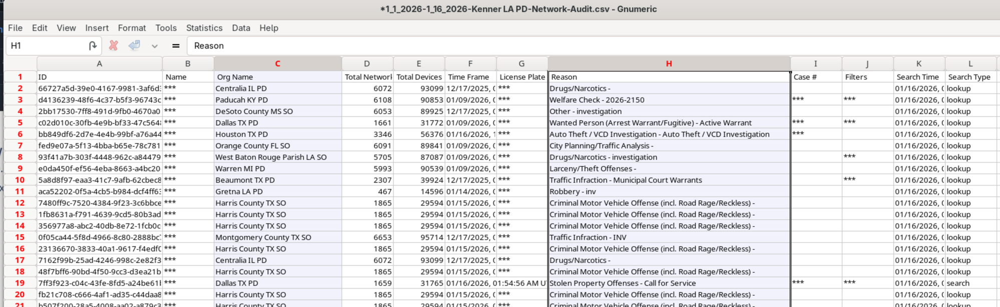

This map shows how many searches of Kenner's cameras came from agencies in each U.S. state.

## How the numbers were built

Flock's export has no "state" column at all — only an agency name, like "Dallas TX PD" or "Cobb County GA SO". Here's a real row from the raw data, opened in a spreadsheet:

Look at the "Org Name" column: "Centralia IL PD", "Paducah KY PD", "DeSoto County MS SO", "Dallas TX PD". The state is sitting right there in the text, but as far as the computer is concerned it's just a name, no different from a person's name. To build this map, every agency's state has to be *read out of that name*, the same way a person skimming the list would.

The approach: look for a two-letter state code inside the name ("Dallas **TX** PD" → Texas), or failing that, a full state name spelled out ("Kansas Highway Patrol" → Kansas). That sounds simple, but a few names are traps for a naive approach:

- **"CO" doesn't always mean Colorado.** It's also short for "County." An agency named "Blaine CO OK SO" (Blaine *County*, Oklahoma, Sheriff's Office) is in Oklahoma, not Colorado — so when a name contains more than one two-letter code, the *last* one is trusted, since the real state abbreviation almost always comes last.
- **"SD" doesn't always mean South Dakota.** It's also short for "Sheriff's Department." "San Diego County **CA** SD" is in California, and the trailing "SD" there means Sheriff's Department, not South Dakota — so that one specific pattern is special-cased.
- Federal agencies (names starting with `[Federal]`, like `[Federal] US Postal Inspection Service`) aren't a state at all and are counted separately, shown in the map's caption rather than colored on the map.

About 0.3% of agencies — regional task forces, railroad police, national nonprofits — genuinely don't belong to any one state, or their name doesn't give enough information to tell. Rather than guess, those are left off the map and listed by name in the script's output.

## Worked example

"Dallas TX PD" → the two-letter scan finds "TX" → Texas. "DeSoto County MS SO" → finds "MS" → Mississippi. "Blaine CO OK SO" → finds two codes, "CO" and "OK"; because the last one is trusted, and because "CO" here means County anyway, the agency counts toward Oklahoma.

## Full detail

Every rule, and the full list of agencies that couldn't be placed, is in `searches_by_state.py` in this folder — including the small number of names where the rules had to be double-checked by hand.
