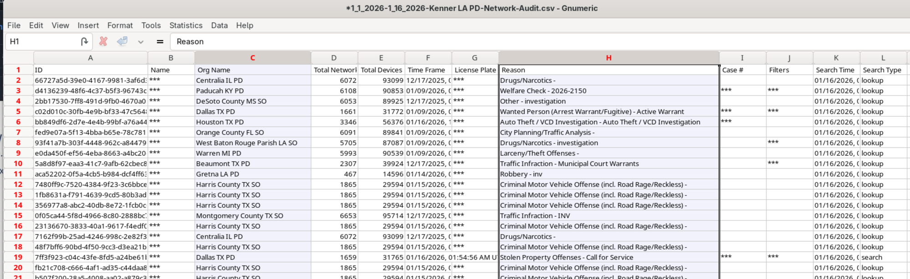

This is a closer look at one agency: the US Postal Inspection Service (USPIS), which ran more searches of Kenner's cameras than every other federal agency combined. The graph breaks down *what USPIS said it was searching for*, and *when*.

## How the numbers were built

Every search in Flock's export carries a "Reason" field — free text an officer typed in at the time, not a dropdown menu. Here's a real row from the raw data:

Notice the Reason column: "Drugs/Narcotics -", "Wanted Person (Arrest Warrant/Fugitive) - Active Warrant", "Welfare Check - 2026-2150". Because it's free text, the same underlying reason gets typed a dozen different ways across thousands of searches — capitalized differently, abbreviated, misspelled, or reduced to a bare case number. Before any chart can show "how many searches were about mail theft," those thousands of raw phrases first have to be sorted into a handful of plain categories.

The sorting works like a checklist, read top to bottom, and the first matching rule wins:

1. A short list of reasons that explicitly mention immigration are pulled out first, by exact match, so they're never accidentally absorbed into a bigger bucket.
2. A few reasons are obviously not real reasons at all — "test", "Training", "Image Download" — and are set aside as their own category.
3. Anything that's just a case number (with or without a short program code attached, like "4222212-MT") is filed as "case number only" — it says *something* was being investigated, but not what.
4. What's left is matched against keyword groups: mentions of "mail theft", "narcotics" or "drug", "robbery" or "carrier", "burglary", "check" or "fraud" or "money order", and so on.
5. Anything that doesn't fit any of the above stays "unclassified" on purpose. A search whose entire reason is just "HS" is *not* guessed to mean "Homeland Security" — it's left alone, and every one of these leftover phrases is printed in full in the script's output so a reader can check the judgment call themselves.

## Worked example

"mail theft", "Mail theft", "Mail Theft", "MT Suspect", and the case number "4222212-MT" are five different phrases typed by five different (or the same) officers — but they all describe the same thing, so they all fold into one category: mail theft. Meanwhile, a reason that's just "HS" stays unclassified, because it's genuinely ambiguous (Homeland Security? Something else entirely?).

Using this method, exactly 5 of USPIS's 52,572 searches have a reason that's explicitly about immigration for example "USPIS/HSI Investigation." Here is every one of the 5, in full — date, search type, and case number as recorded

| Date | Search type | Reason | Case number |
|---|---|---|---|
| 2025-06-13 | search | USPIS/HSI Investigation | redacted (`***`) |
| 2025-06-13 | lookup | USPIS/HSI Investigation | *(blank)* |
| 2025-09-19 | lookup | ERO MKE suspect | redacted (`***`) |
| 2025-09-19 | lookup | ERO MKE suspect | redacted (`***`) |
| 2025-11-21 | lookup | ERO MKE suspect | redacted (`***`) |

## Full detail

The complete list of category rules, every case-number program code, and every single "unclassified" phrase (over 700 of them) are printed by `usps_deep_dive.py` in this folder.
